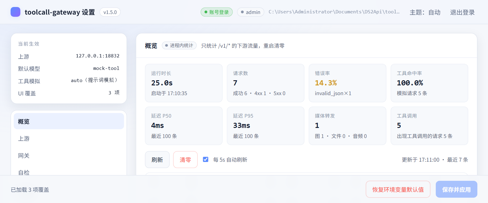
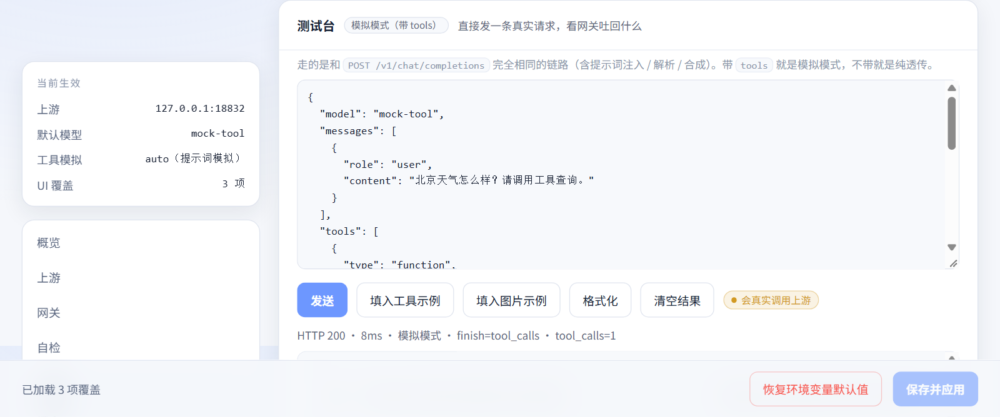

# toolcall-gateway

[](https://github.com/kaoqy/tool-calls-gateway/actions/workflows/docker-publish.yml)
[](https://github.com/kaoqy/tool-calls-gateway/pkgs/container/toolcall-gateway)
[](LICENSE)

> **OpenAI 兼容 · 工具调用模拟** 轻量中转网关。
> 让「只支持纯聊天」的上游模型（如 DeepSeek 纯聊天接口）在不改造下游 Agent / SDK / 客户端的前提下，**变相支持 `tool_calls`**。

```
下游 Agent / SDK（按 OpenAI 工具调用协议工作）
      │  tools + tool_choice + assistant.tool_calls + role:tool（+ 图片）
      ▼
┌───────────────────────────────────────────┐
│ toolcall-gateway                          │
│  ① 注入系统提示词：把 tools 变成文字约定      │
│  ② 历史归一化：tool_calls / tool → 纯文本    │
│  ③ 剥离 tools / function_call 等上游不认的字段│
│  ④ 解析 <tool_call> 块 → 标准 tool_calls     │
│  ⑤ 图片 / 文件 / 音频原样转发（不改写、不丢弃）│
└───────────────────────────────────────────┘
      │  只发 messages（纯聊天）
      ▼
上游纯聊天模型（OpenAI 兼容，但不支持 function calling）
```

| 能力 | 说明 |
| --- | --- |
| 工具调用模拟 | 带 `tools` 的请求 → 提示词注入 → 解析 → 返回标准 `tool_calls`（含并行、流式、多轮） |
| 纯聊天透传 | **不带 `tools` 的请求字节级透传**，请求体/响应/SSE 原样过，零解析零缓冲 |
| 多模态 | 图片 `image_url` / `input_image`、`file`、`input_audio` 原样转发；三态 `imageMode` 可选 |
| 应用内配置 | `/admin` 里改上游、模型映射、超时、体积上限，保存即热生效，**不用改 env、不用重启** |
| 账号保护 | 首次访问创建管理员（scrypt 哈希 + HttpOnly 会话），可选 `ADMIN_TOKEN` 兜底 |
| 可观测 | `/admin` 概览：请求数、错误率、工具命中率、P50/P95、媒体计数；请求测试台可直接发请求验证 |
| 运行时 | Node 20 单进程，**零运行时依赖**（只用 `node:` + 全局 `fetch`），单镜像、非 root、带 HEALTHCHECK |

<p align="center">
  
  
</p>

---

## 已经部署了？一键更新

> 更新只替换容器内的代码，**数据都在数据卷 `tcg-data` 里**（`auth.json` / `settings.json`），账号、上游配置、模型映射全部保留，端口不变、无需迁移。

### 方式 A · 一键脚本（推荐，幂等）

```bash
curl -fsSL https://raw.githubusercontent.com/kaoqy/tool-calls-gateway/main/deploy.sh | sh
```

已经在跑也一样：拉最新镜像 → 重建容器 → 轮询 `/healthz` → 打印访问地址。重复执行不会丢配置。

### 方式 B · docker compose

```bash
cd toolcall-gateway
docker compose pull          # 或：docker compose -f docker-compose.prod.yml pull
docker compose up -d
```

### 方式 C · `docker run` 起的

```bash
docker pull ghcr.io/kaoqy/tool-calls-gateway:latest
docker rm -f toolcall-gateway
docker run -d --name toolcall-gateway -p 8787:8787 \
  -v tcg-data:/app/data --restart unless-stopped \
  ghcr.io/kaoqy/tool-calls-gateway:latest
```

### 更新后 30 秒自检

```bash
curl -s localhost:8787/healthz
# {"status":"ok","version":"1.5.0","setupRequired":false,"upstreamConfigured":true,"imageMode":"pass",...}
```

- `version` 变成 `1.5.0` → 更新成功（容器内 `/healthz` 也返回版本号，HEALTHCHECK 用的就是它）。
- `setupRequired:false` → 账号还在，不用重新初始化。
- 打开 `/admin` → 「概览」能看到新的请求在累加；「测试台」发一条即可验证整条链路。

### 回滚到某个版本

```bash
TCG_IMAGE=ghcr.io/kaoqy/tool-calls-gateway:1.4.0 sh deploy.sh
```

```yaml
# 或直接改 compose 里的 image
image: ghcr.io/kaoqy/tool-calls-gateway:1.4.0
```

### 版本在哪里看

| 位置 | 值 |
| --- | --- |
| `GET /healthz` | `version` 字段 |
| `/admin` 顶栏 | `v1.5.0` 徽标 |
| 镜像标签 | `1.5.0` / `1.5` / `latest` / `sha-xxxxxxx` |

---

## 版本历史（最近）

| 版本 | 主要变化 |
| --- | --- |
| **1.5.0** | `/admin` 增加**概览**（请求/错误率/工具命中率/P50-P95/媒体计数 + 最近请求表）、**请求测试台**（直接发真实请求看响应）、四种**接入片段**一键复制、**主题切换**；`/healthz` 带版本号 |
| 1.4.0 | 修复多模态静默丢图：图片/文件/音频原样转发；`imageMode` 三态；请求体上限 2MB → 16MB；视觉自检；上游不支持视觉时的可读错误 |
| 1.3.0 | 零配置部署：首次访问 `/admin` 创建管理员 + 配上游，不再需要任何环境变量 |
| 1.2.0 | 设置页 UI 重构（侧边栏摘要 / 脏状态保存条 / 模型表 / 接入信息） |
| 1.1.1 | 设置页登录（`ADMIN_TOKEN` + Cookie），修复容器内 `/admin` 401 |

完整变更与每次 gate 的真实输出见 [LEDGER.md](LEDGER.md)。

---

## 更多文档

| 想看什么 | 去哪 |
| --- | --- |
| 首次部署 / 全量环境变量 / 端点表 / 客户端接入（curl / Python / Node / Codex） | [docs/FULL.md](docs/FULL.md) |
| 多模态细节（part 处理表、`imageMode` 三态、体积与超时） | [docs/FULL.md · 多模态](docs/FULL.md#-多模态图片--文件--音频) |
| 协议细节（请求改写、历史归一化、流式策略、reasoning 隔离） | [docs/FULL.md · 协议细节](docs/FULL.md#5-协议细节) |
| 测试与验收（14 个离线 gate、conformance 35 项、live 脚本） | [docs/FULL.md · 测试与验收](docs/FULL.md#7-测试与验收) |
| 安全模型与限制 | [docs/FULL.md · 安全](docs/FULL.md#10-安全) |

## 许可

MIT。上游密钥只存在你自己的数据卷里，网关不向外发送任何遥测。
