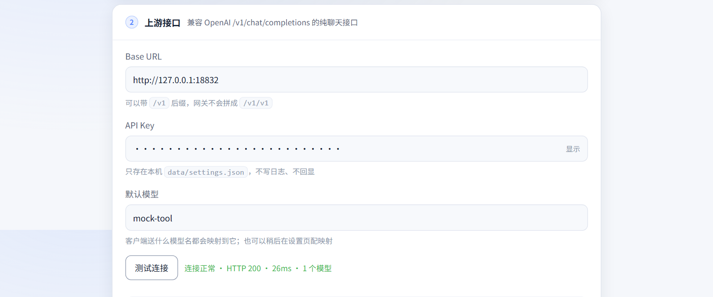
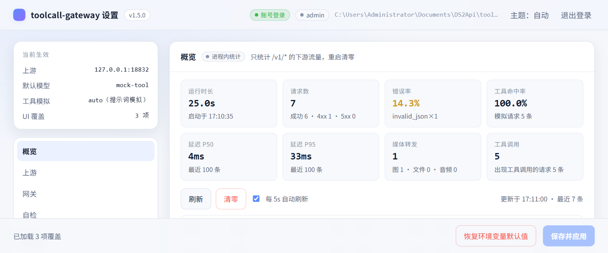
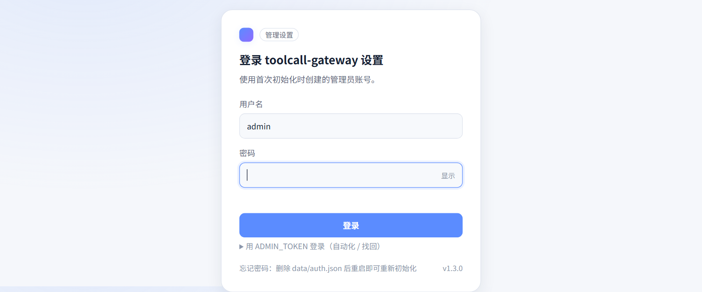

# toolcall-gateway · 完整指南

> 部署、配置、协议细节、测试与发布流程都在这里。README 只保留「项目介绍 + 已部署如何一键更新」。

[← 返回 README](../README.md)

---
[](https://github.com/kaoqy/tool-calls-gateway/actions/workflows/docker-publish.yml)
[](https://github.com/kaoqy/tool-calls-gateway/pkgs/container/toolcall-gateway)

> **OpenAI 兼容 · 工具调用模拟** 轻量中转网关。
> 让「只支持纯聊天」的上游模型（如 DeepSeek 纯聊天接口）在不改造下游 Agent / SDK / 客户端的前提下，**变相支持 tool_calls**。

- 运行时：Node.js 20+（ESM，`.mjs`），**零运行时依赖**（只用 `node:` 内置模块 + 全局 `fetch`），无构建步骤。
- 部署：单镜像 `node:20-alpine`，非 root（`USER node`），带 `HEALTHCHECK`；**零配置**——不填任何环境变量，起容器后在 `/admin` 网页里完成初始化。
- 多模态：带 `tools` 的请求也会把图片/文件/音频**原样转发**上游（v1.4.0 起；旧版会静默丢弃图片），见 [🖼 多模态](#-多模态图片--文件--音频)。
- 无状态：网关不保存任何会话，见 [协议假设](#协议的硬性假设)。

## 🚀 部署（零配置）

> 已发布镜像：**`ghcr.io/kaoqy/tool-calls-gateway:v1.4.0`**（`linux/amd64` + `linux/arm64`，push tag 时由 GitHub Actions 自动构建推送）

**不需要任何环境变量**：不填上游、不填密钥、不用准备 `.env`。把容器起来，打开网页，第一次访问时创建管理员账号 + 填上游，保存即生效。

```bash
docker run -d --name toolcall-gateway -p 8787:8787 \
  -v tcg-data:/app/data --restart unless-stopped \
  ghcr.io/kaoqy/tool-calls-gateway:v1.4.0
```

然后浏览器打开 **`http://<host>:8787/admin`** —— 这就是全部初始化。

**唯一需要记住的事**：`/app/data` 必须挂在卷上（上面的 `-v tcg-data:/app/data` 已经做了），否则容器重建会丢账号和上游配置。

### 方式 A · 一键脚本（推荐）

```bash
curl -fsSL https://raw.githubusercontent.com/kaoqy/tool-calls-gateway/main/deploy.sh | sh
```

脚本一次跑完：拉镜像 → 起容器（带数据卷与 healthcheck）→ 轮询 `/healthz` → 打印设置页地址。中途不要你填任何东西。

### 方式 B · docker compose

```bash
git clone https://github.com/kaoqy/tool-calls-gateway.git && cd tool-calls-gateway
docker compose -f docker-compose.prod.yml up -d      # 用预构建镜像
# 想自己构建：docker compose up -d --build
```

`docker-compose.prod.yml` 带 `read_only` + `no-new-privileges` + `tmpfs /tmp`，配置持久化在 named volume `tcg-data:/app/data`。两个 compose 文件都**不引用 `.env`**，所以不需要先 `cp .env.example .env`。

### 方式 C · docker run（已有编排 / 临时验证）

```bash
docker run -d --name toolcall-gateway \
  -p 8787:8787 \
  -v tcg-data:/app/data \
  --restart unless-stopped \
  ghcr.io/kaoqy/tool-calls-gateway:v1.4.0

docker logs toolcall-gateway | tail -5     # 未初始化时日志会提示去 /admin
curl -s localhost:8787/healthz             # {"status":"ok","setupRequired":true,...}
```

### 首次访问（三步，全在网页里）

1. **创建管理员**：用户名 + 密码（≥8 位）。这是 `/admin` 的登录凭据，只存在 `data/auth.json`（scrypt 哈希，不存明文）。
2. **填上游**：Base URL、API Key、默认模型 → 点 **测试连接**，会真的探一次 `/v1/models` 并标注每个模型的 `supports_tool_call`（`false` 说明必须走提示词模拟，正是本网关的场景）。
3. **完成初始化** → 自动登录进控制台，配置已落盘且**立即生效**，不用重启。



<sub>填完点「测试连接」会列出上游模型并标注 `supports_tool_call`，再点「完成初始化」。</sub>

> 初始化完成前，任何能访问该端口的人都可以创建这个账号（与 Jellyfin / Grafana 首次安装一致）。要避免这个窗口：先设 `ADMIN_TOKEN`，或只在信任的网络里暴露端口。

### 部署后自检

```bash
curl -s localhost:8787/healthz
# {"status":"ok","setupRequired":false,"upstreamConfigured":true}

curl -s localhost:8787/v1/models | head -c 300        # 有没有真打到上游

curl -s localhost:8787/v1/chat/completions \
  -H 'content-type: application/json' \
  -d '{"model":"deepseek-chat","messages":[{"role":"user","content":"北京天气？"}],
       "tools":[{"type":"function","function":{"name":"get_weather","description":"查天气",
       "parameters":{"type":"object","properties":{"city":{"type":"string"}},"required":["city"]}}}]}' \
  | head -c 400
```

预期：`healthz` 两项都是 `true`；第三个请求返回 `finish_reason: "tool_calls"` 与 `tool_calls[0].function.arguments`。
也可以直接在 `/admin` 的「自检」里点两个按钮（**测试连接** / **工具模拟自检**），不用敲命令。

### 数据与备份

| 文件（容器内） | 内容 | 备份 / 迁移 |
| --- | --- | --- |
| `/app/data/auth.json` | 管理员账号（scrypt 哈希） | 复制走即可；删掉后重启 = 重新初始化 |
| `/app/data/settings.json` | UI 保存的配置（含上游密钥，0600） | 同上；删掉 = 回落 env / 默认值 |

```bash
# 导出配置（含密钥，注意保管）
docker run --rm -v tcg-data:/data -v "$PWD":/out alpine tar czf /out/tcg-backup.tgz -C /data .
```

**忘了密码**：删 `auth.json` 后重启容器，`/admin` 会重新回到初始化向导（上游配置不受影响）。

### 部署常见问题

| 现象 | 原因 / 处理 |
| --- | --- |
| `/v1` 返回 `503 upstream_not_configured` | 还没配上游：打开 `/admin` 填好并保存 |
| 打开 `/admin` 是"初始化"页而不是登录页 | 正常：本实例还没创建管理员账号，按提示填完即可 |
| 打开 `/admin` 是登录页，忘了账号 | 用户名在 `/healthz` 看不到，看 `docker logs` 里的 `adminAccount` 一行；或删 `auth.json` 重置 |
| 登录报"尝试过于频繁" | 同来源 5 次失败会锁 5 分钟；确实忘了密码就删 `auth.json` |
| 拉取镜像 `denied` | 镜像/仓库是私有的：`echo $GITHUB_TOKEN \| docker login ghcr.io -u <用户名> --password-stdin` |
| 上游返回 `403 需要重新登录或人机验证` | 上游是 web 类模型通道，触发了反爬；网关原样透传，换 API 计费通道或降低调用频率 |
| 容器重建后账号/配置没了 | 没挂 `/app/data` 卷；用上面的 `-v tcg-data:/app/data` |
| 想改端口 | `-p 9000:8787`；容器内始终监听 8787 |

> 下游 SDK 的 `base_url` 指向 `http://<host>:8787/v1`（见 [4. 客户端接入示例](#4-客户端接入示例)）。
> 若在 `/admin` 里设了「下游网关 Key」，客户端需带 `Authorization: Bearer <该 Key>`；不设则任意 key 放行。发往上游时始终改用你配的上游 Key。

---

## 🖥 应用内设置（不用改 env）

打开 **`http://<host>:8787/admin`**，在网页里改上游并**立即热生效**——不用改 `.env`、不用重启、不用重建容器。



左侧常驻「当前生效」摘要（上游 host / 默认模型 / 工具模拟 / UI 覆盖项数），中间是分区表单，底部是保存条——有改动才会点亮「保存并应用」，`Ctrl/Cmd + S` 也能保存。

| 分类 | 可改字段 |
| --- | --- |
| 上游 | `upstreamBaseUrl`、`upstreamApiKey`（掩码回显）、`defaultModel`、`modelMap`、`modelOverride` |
| 网关 | `gatewayApiKey`（掩码回显）、`toolMode`、`reasoningPassthrough`、`requestTimeoutMs`、`maxBodyBytes` |

优先级：**UI 保存的设置文件 > 环境变量 > 内置默认值**。每个字段旁边都有来源徽标（`UI 已覆盖` / `来自 env` / `默认值`），不会出现"到底哪个生效"的歧义。

- **密钥不回显**：只返回 `sk-***abcd` 形式的 hint；留空保存 = 不修改，填新值 = 覆盖；输入框旁有「显示/隐藏」。
- **测试连接**：用当前表单值（不保存）打一次 `GET /v1/models`，返回状态码、延迟与模型列表。
- **列出模型**：表格列出上游模型并标注 `supports_tool_call`，每行可一键「设为默认」（`false` 就说明必须走提示词模拟）。
- **工具模拟自检**：用保存的配置真发一次带 `tools` 的请求（**消耗 1 次上游调用**），直接显示 `finish_reason`、`tool_calls` 数量与参数样例。
- **接入信息**：页面底部给出本实例的 Base URL / Chat Completions / 健康检查地址与一段可复制的 `curl`（自动带上当前默认模型与网关 Key 状态）。
- **恢复环境变量默认值**：一键清空所有 UI 覆盖项（删除设置文件）。
- **账号**：独立的「账号」分区可以改密码（改完其它浏览器的会话立刻失效）与退出登录。
- **鉴权**：只有一个模型——**首次访问创建的管理员账号**。
  - 账号不存在时：`/admin` 是**初始化向导**（创建账号 + 填上游），任何能访问该端口的人都可以完成这一次（同 Jellyfin / Grafana）。
  - 账号存在后：`/admin` 一律要登录（用户名 + 密码 → `HttpOnly` + `SameSite=Lax` 的会话 Cookie，7 天）；密码用 `scrypt` 加盐哈希，只存 `data/auth.json`。
  - 登录页长这样（用户名会回填）：

  

  - 同来源连续 5 次登录失败会锁 5 分钟（`429` + `Retry-After`）。
  - 可选 `ADMIN_TOKEN`：给自动化或"忘记密码"留一把 `Authorization: Bearer` 的后门（也可在登录页折叠区里贴令牌）。
- **持久化**：`DATA_DIR`（默认 `data/`）下两个 0600 文件——`auth.json`（账号）、`settings.json`（配置）。容器部署务必挂 volume（compose 已内置 `tcg-data:/app/data`），否则重建会丢。

> 安全提示：设置页能改上游地址，等价于一个"代理配置"入口。初始化完成后它就受账号保护；要在公网暴露时，优先放在带鉴权的反代之后，或先设 `ADMIN_TOKEN` 再开放端口。

## 🖼 多模态（图片 / 文件 / 音频）

> **先说清楚边界**：不带 `tools` 的普通聊天请求，网关一直是**字节级透传**——请求体原样发给上游，图片本来就能过去，这次没有改它。
> 本次修的是**模拟模式**（带 `tools`/`functions`）下的静默丢弃：旧实现里 `contentToText()` 只取 `text` part，图片被默默扔掉且没有任何日志。

### 模拟模式下每个 part 的处理方式

| 客户端发来的 part | 网关动作 |
| --- | --- |
| `{type:'text', text}` | 原样保留（不合并、不重排；空串也保留） |
| `{type:'image_url', image_url:'data:...'}` | 规范成 `{type:"image_url", image_url:{url}}`，base64 逐字节不变 |
| `{type:'image_url', image_url:{url, detail}}` | 原样保留 `url` 与 `detail` |
| `{type:'input_image', image_url|image_data}` | 原样保留（部分上游用这个变体） |
| `{type:'file', file:{filename, file_data|file_id}}` | 原样保留（data URL 前缀不动） |
| `{type:'input_audio', input_audio:{data, format}}` | 原样保留 |
| 未识别的类型（如 `video`） | **fail-open 原样透传** + 计数 + `warn`（只打 type 名，不打内容） |

同角色连续两条多模态消息合并时，`content` 保持**数组**（不会再被拼成字符串、出现 `[object Object]`）；
`role:"tool"` 的结果转成 user 消息时，`<tool_result>` 文本块与媒体 part 一起保留。

### imageMode 三态

在 `/admin` →「网关」→「图片处理模式」里改（有 `来自 env / UI 已覆盖 / 默认值` 徽标），也可以用环境变量 `IMAGE_MODE` 给默认值：

| 值 | 行为 | 什么时候用 |
| --- | --- | --- |
| `pass`（默认） | 图片/文件/音频原样转发上游 | 上游支持视觉，或你希望自己兜住上游报错 |
| `placeholder` | 媒体替换成 `[图片]` / `[文件: name]` / `[音频]` 占位文本 | 上游明确不支持视觉，只想让它别报错 |
| `reject` | 模拟模式下遇到媒体直接 `400 vision_unsupported` | 想尽早暴露"客户端在发图但上游看不了" |

### 体积与超时

- 请求体上限默认 **16MB**（原来是 2MB，一张图 base64 就能超；base64 体积 ≈ 原图 × 1.37）。
- 边读边累加字节、超限立刻中断：返回 `413 payload_too_large`，错误里带**实际大小**、**上限**和"可在 /admin「网关」分区调大 maxBodyBytes"。
- 单请求图片数 > 8 或单个 part > 8MB → 同样 413（防 OOM），不硬扛。
- 含媒体的请求自动把超时放宽到 `max(配置值, 120000ms)`，日志里注明 `media timeout widened`。

### 上游不支持视觉时

上游返回 `400/422` 且错误体提到 image / vision / multimodal / content type 时，网关把错误归一化成：

```json
{ "error": { "type": "upstream_vision_unsupported",
             "message": "上游模型可能不支持图片输入。可在 /admin 把 imageMode 改为 placeholder（媒体转占位文本后重试），或换一个支持视觉的上游模型。",
             "upstreamStatus": 400,
             "upstream": "…（脱敏后的上游原文，最多 500 字）" } }
```

`/admin` →「自检」→ **视觉自检** 可以直接验：发一张内嵌的 1×1 PNG（69 字节，不读文件）+ `tools`，报告上游是否接受、延迟、以及 file/PDF 的已知限制（网关不会把 PDF 转图片，也不打算为此引入依赖）。

### 日志纪律

每条模拟请求记一条 info：`media forwarded images=… files=… audios=… unknownParts=… mode=… parts=[{type,mime,bytes,urlKind,host}]`。
**绝不打印 base64 内容**：data URL 只显示 `<inline data URL, N bytes> <mime>`，http(s) 只显示 host；未识别 part 只显示 type 名。

---
## 1. 它解决什么问题

```
下游 Agent/SDK（按 OpenAI 工具调用协议工作）
        │  tools + tool_choice + assistant.tool_calls + role:tool
        ▼
┌─────────────────────────────────────────────┐
│ toolcall-gateway                            │
│  ① 注入系统提示词（把 tools 变成文字约定）      │
│  ② 历史归一化（tool_calls/tool → 纯文本）      │
│  ③ 剥离 tools/function_call/response_format   │
│  ④ 解析模型的 <tool_call> 块 → 标准 tool_calls │
└─────────────────────────────────────────────┘
        │  只发 messages（纯聊天）
        ▼
上游纯聊天模型（OpenAI 兼容 /v1/chat/completions，但不支持 function calling）
```

- **带 `tools`/`functions` 的请求** → 走「模拟模式」：用提示词让模型输出结构化 `<tool_call>` 块，网关解析成标准 `tool_calls` 返回。
- **不带工具的请求** → **字节级透传**：请求体原样发给上游，响应（含 SSE 流）原样返回，零解析、零缓冲。

## 2. 快速开始

### 2.1 本机裸跑（Node 20+）

```bash
node src/server.mjs          # 零配置：起来后打开 http://127.0.0.1:8787/admin 初始化
# 或 npm start
```

想用 env 预置（CI / 不想动网页）时再加载文件：

```bash
node --env-file=.env src/server.mjs
```

### 2.2 Docker

```bash
docker build -t toolcall-gateway:dev .
docker run --rm -p 8787:8787 -v tcg-data:/app/data toolcall-gateway:dev
curl -s localhost:8787/healthz      # {"status":"ok","setupRequired":true,"upstreamConfigured":false}
```

### 2.3 docker compose

```bash
docker compose up -d --build        # 读 docker-compose.yml，不需要 .env
curl -s localhost:8787/healthz
docker compose logs -f
docker compose down
```

### 2.4 环境变量（**全部可选**）

> 正常使用不需要任何环境变量：上游、密钥、管理员账号都在 `/admin` 里配。
> 这里的变量只用于 CI 预置、自动化、或调整运行参数；**网页里保存的值优先级更高**。

| 变量 | 默认值 | 说明 |
| --- | --- | --- |
| `PORT` | `8787` | 监听端口 |
| `UPSTREAM_BASE_URL` | 空 | 上游 base（可带 `/v1`，网关会避免拼成 `/v1/v1`）。留空时 `/v1` 返回 `503 upstream_not_configured` |
| `UPSTREAM_API_KEY` | 空 | 上游密钥，**只从环境/设置文件读，永不写日志** |
| `DEFAULT_MODEL` | 空 | 请求未带 `model` 时使用 |
| `TOOL_MODE` | `auto` | `auto`=含 tools 时模拟；`off`=完全透传（不模拟，上游会因 tools 报错，仅用于排查） |
| `REQUEST_TIMEOUT_MS` | `60000` | 单次上游请求总超时（含流式），超时返回 `504 upstream_timeout` |
| `MAX_BODY_BYTES` | `16777216`（16MB） | 入站请求体上限，超出返回 `413 payload_too_large`。多模态图片按 base64 体积算，边读边计字节、超限立刻中断 |
| `LOG_LEVEL` | `info` | `debug` 会打印注入后的上游 prompt（密钥仍被脱敏） |
| `MODEL_MAP` | 空 | 客户端模型名 → 真实上游模型。支持 JSON `{"gpt-5-codex":"deepseek-web-flash"}` 或 `gpt-5-codex:deepseek-web-flash,gpt-4o:deepseek-web-flash` |
| `MODEL_OVERRIDE` | 空 | **硬覆盖**：任何请求都改写成这个上游模型（优先级最高） |
| `GATEWAY_API_KEY` | 空 | 设置后校验下游 `Authorization: Bearer <key>`；发往上游时始终改用 `UPSTREAM_API_KEY`（客户端 key 不外泄） |
| `REASONING_PASSTHROUGH` | `on` | `on` 时把上游 `reasoning_content`/`reasoning` 原样挂在响应 message（及流式 `delta.reasoning_content`）上，**不并入 content** |
| `IMAGE_MODE` | `pass` | 多模态处理：`pass` 原样转发 / `placeholder` 占位文本 / `reject` 含媒体直接 400 |
| `MAX_IMAGES_PER_REQUEST` | `8` | 单请求图片数上限（超出 413，防 OOM） |
| `MAX_MEDIA_PART_BYTES` | `8388608`（8MB） | 单个媒体 part 上限（超出 413） |
| `MEDIA_TIMEOUT_MS` | `120000` | 含媒体请求的最小上游超时（取与 `REQUEST_TIMEOUT_MS` 的较大值） |
| `ADMIN_TOKEN` | 空 | 可选的管理令牌（自动化 / 忘记密码时兜底），用 `Authorization: Bearer <ADMIN_TOKEN>` 直接访问 `/admin` |
| `DATA_DIR` | `data` | 数据目录：`auth.json`（管理员）+ `settings.json`（配置），均 0600。容器内务必挂 volume |
| `SETTINGS_FILE` / `AUTH_FILE` | 空 | 直接指定文件完整路径，优先级高于 `DATA_DIR` |
| `LIVE_MODEL` | `deepseek-web-flash` | live 脚本使用的真实模型 |
| `MAX_LIVE_CALLS` | `40` | 每个 live 脚本进程最多打多少次真实上游（超出直接抛错并停止） |
| `LIVE_DELAY_MS` | `1500`/`2000` | live 脚本的请求间隔（节流，避免触发 web 类上游的风控/人机验证） |

## 3. 端点

| 方法 | 路径 | 行为 |
| --- | --- | --- |
| GET | `/healthz` | `{"status":"ok","setupRequired":<bool>,"upstreamConfigured":<bool>,"imageMode":"pass","maxBodyBytes":16777216}`（HEALTHCHECK / 部署自检用） |
| GET | `/v1/models` | 透传上游（未配上游时 503） |
| POST | `/v1/chat/completions` | 含 `tools`/`functions` → 模拟；否则透传（未配上游时 503） |
| GET | `/admin` | 初始化向导 / 登录页 / 控制台（HTML，单文件无外部资源） |
| POST | `/admin/api/setup` | **首次初始化**：创建管理员 + 写入上游配置，返回会话 Cookie（账号已存在时 409） |
| POST | `/admin/api/setup/test` | 初始化过程中的「测试连接」（用表单里的候选配置探 `/v1/models`，不保存） |
| GET | `/admin/api/session` | 当前是否已初始化 / 是否已登录 |
| POST | `/admin/api/login` | 用户名 + 密码换会话 Cookie（7 天）；也接受 `{token: ADMIN_TOKEN}` |
| POST | `/admin/api/logout` | 撤销当前会话 Cookie |
| POST | `/admin/api/password` | 改密码（校验当前密码，成功后其它会话全部失效） |
| GET | `/admin/api/settings` | 当前生效配置（密钥掩码）+ 每个字段的来源 |
| PUT | `/admin/api/settings` | 保存并热生效（只接受白名单字段，空值 = 取消覆盖） |
| POST | `/admin/api/settings/reset` | 清除全部 UI 覆盖项，回落 env/默认值 |
| POST | `/admin/api/test` | 用候选配置测试上游 `GET /models`（不保存） |
| POST | `/admin/api/test-tool` | 用当前配置跑一次工具模拟自检（消耗 1 次上游调用） |
| POST | `/admin/api/test-vision` | 视觉自检：发一张内嵌 1×1 PNG + tools，报告上游是否接受图片（消耗 1 次上游调用） |

`/admin*` 的鉴权：初始化窗口内（账号不存在）只有 `setup` / `setup/test` / `session` / `GET /admin` 可用；创建账号后除 `login` / `session` 外都需要登录会话（或 `ADMIN_TOKEN`）。

错误统一为 OpenAI 风格：

```json
{ "error": { "type": "upstream_timeout", "message": "上游响应超时" } }
```

常见 `type`：`invalid_json` / `invalid_request_error` / `payload_too_large` / `upstream_not_configured` / `upstream_timeout` / `upstream_error` / `admin_unauthorized` / `auth_bad_credentials` / `too_many_attempts` / `not_found` / `internal_error`。

## 4. 客户端接入示例

网关对下游而言就是一个 OpenAI 兼容端点，把 `base_url` 指过来即可（密钥随便填非空值，真正的密钥在网关侧）。

### 4.1 curl：带工具

```bash
curl -s http://localhost:8787/v1/chat/completions \
  -H 'content-type: application/json' \
  -H 'authorization: Bearer any-value' \
  -d '{
    "model": "deepseek-chat",
    "messages": [{"role":"user","content":"北京天气怎么样？"}],
    "tools": [{
      "type": "function",
      "function": {
        "name": "get_weather",
        "description": "查询城市天气",
        "parameters": {"type":"object","properties":{"city":{"type":"string"}},"required":["city"]}
      }
    }]
  }'
```

返回：

```json
{
  "id": "chatcmpl-…",
  "object": "chat.completion",
  "created": 1700000000,
  "model": "deepseek-chat",
  "choices": [{
    "index": 0,
    "message": {
      "role": "assistant",
      "content": null,
      "tool_calls": [{
        "id": "call_…",
        "type": "function",
        "function": { "name": "get_weather", "arguments": "{\"city\":\"北京\"}" }
      }]
    },
    "finish_reason": "tool_calls"
  }],
  "usage": { "prompt_tokens": 0, "completion_tokens": 0, "total_tokens": 0 }
}
```

### 4.2 curl：不带工具（纯透传）

```bash
curl -s http://localhost:8787/v1/chat/completions \
  -H 'content-type: application/json' \
  -d '{"model":"deepseek-chat","messages":[{"role":"user","content":"你好"}]}'
```

### 4.3 OpenAI Python SDK

```python
from openai import OpenAI

client = OpenAI(base_url="http://localhost:8787/v1", api_key="not-needed")

tools = [{
    "type": "function",
    "function": {
        "name": "get_weather",
        "description": "查询城市天气",
        "parameters": {"type": "object",
                       "properties": {"city": {"type": "string"}},
                       "required": ["city"]},
    },
}]

messages = [{"role": "user", "content": "北京天气怎么样？"}]
resp = client.chat.completions.create(model="deepseek-chat", messages=messages, tools=tools)
msg = resp.choices[0].message
print(resp.choices[0].finish_reason)      # tool_calls
print(msg.tool_calls[0].function.name)    # get_weather
print(msg.tool_calls[0].function.arguments)

messages.append(msg)                       # 回传 assistant（含 tool_calls）
messages.append({
    "role": "tool",
    "tool_call_id": msg.tool_calls[0].id,
    "name": msg.tool_calls[0].function.name,
    "content": '{"city":"北京","temp":"25C","text":"晴"}',
})
final = client.chat.completions.create(model="deepseek-chat", messages=messages, tools=tools)
print(final.choices[0].finish_reason)      # stop
print(final.choices[0].message.content)    # 最终自然语言答案
```

### 4.4 OpenAI Node SDK

```js
import OpenAI from 'openai';

const client = new OpenAI({ baseURL: 'http://localhost:8787/v1', apiKey: 'not-needed' });

const tools = [{
  type: 'function',
  function: {
    name: 'get_weather',
    description: '查询城市天气',
    parameters: { type: 'object', properties: { city: { type: 'string' } }, required: ['city'] },
  },
}];

const messages = [{ role: 'user', content: '北京天气怎么样？' }];
const first = await client.chat.completions.create({ model: 'deepseek-chat', messages, tools });
const call = first.choices[0].message.tool_calls?.[0];

messages.push(first.choices[0].message);
messages.push({ role: 'tool', tool_call_id: call.id, name: call.function.name, content: '{"text":"晴"}' });

const second = await client.chat.completions.create({ model: 'deepseek-chat', messages, tools });
console.log(second.choices[0].finish_reason, second.choices[0].message.content);
```

### 4.5 流式（stream: true）

```bash
curl -N http://localhost:8787/v1/chat/completions \
  -H 'content-type: application/json' \
  -d '{"model":"deepseek-chat","stream":true,"messages":[{"role":"user","content":"北京天气？"}],
       "tools":[{"type":"function","function":{"name":"get_weather","description":"查天气",
       "parameters":{"type":"object","properties":{"city":{"type":"string"}},"required":["city"]}}}]}'
```

含工具时收到的是网关**合成**的 SSE（`role` 首包 → 工具首包带 `id/type/name` → `arguments` 分片 → `finish_reason: "tool_calls"` → `data: [DONE]`），与 OpenAI 官方流的形状一致，SDK 可直接消费。

### 4.6 Codex 类应用接入（config.toml）

Codex 用 `wire_api = "chat"` 走 Chat Completions，把 `base_url` 指到网关即可。模型名随便写（例如 `gpt-5-codex`），由网关的 `MODEL_MAP` 映射到真实上游模型：

```toml
# ~/.codex/config.toml
model = "gpt-5-codex"          # 由网关 MODEL_MAP 映射到 deepseek-web-flash
model_provider = "tcgateway"

[model_providers.tcgateway]
name = "ToolCall Gateway"
base_url = "http://127.0.0.1:8787/v1"
env_key = "GATEWAY_API_KEY"    # 网关设置了 GATEWAY_API_KEY 时，Codex 侧填同一个值
wire_api = "chat"
```

对应 `.env`：

```bash
MODEL_MAP={"gpt-5-codex":"deepseek-web-flash","gpt-5":"deepseek-web-flash"}
GATEWAY_API_KEY=local-dev-key
```

请求形状（`scripts/e2e_codex.mjs` 实测的形状）：`stream: true` + `stream_options.include_usage: true` + `tools:[{name:"shell", parameters:{command, workdir, timeout}}]` + 大段系统指令。网关返回的是标准 SSE `tool_calls` 分片（`id/type/name` 首包 → `arguments` 分片 → `finish_reason:"tool_calls"` → `[DONE]`），SDK 可直接消费。

> ⚠️ Codex 的 `apply_patch` 是**自由文本 / grammar 工具**，不是 JSON-schema function，见 6.1 的「已知不支持」。需要改文件时，建议让 Codex 降级用 `shell` 工具（`cat > file <<'EOF'`）完成，或把该工具接到原生工具上游。


## 5. 协议细节

### 5.1 请求改写（客户端 → 上游）

含 `tools`/`functions` 时：

1. 取出 `messages` 做历史归一化（见 5.2）。
2. 在**最前面**注入系统提示词模板，`{{TOOLS_JSON}}` 填入 `tools[i].function` 归一化后的 JSON（旧式 `functions` 同样转换）。
3. 按 `tool_choice` 追加约束句：`required`/`any` → 强制至少调用一次；`{"type":"function","function":{"name":"X"}}` → 强制调用 X；`none` → 禁止调用；`auto` → 不追加。
4. **剥离**：`tools`、`tool_choice`、`functions`、`function_call`、`parallel_tool_calls`、`response_format`，以及任何不在白名单里的字段（上游不认识就报错）。
5. **透传**：`model`、`temperature`、`top_p`、`max_tokens`、`stop`、`presence_penalty`、`frequency_penalty`、`seed`、`stream`、`stream_options`。

> `response_format` 被剥离：多数纯聊天上游不支持 JSON mode；如果需要结构化输出，请让模型直接在正文里输出 JSON。

### 5.2 历史归一化

| 原始 | 归一化后 |
| --- | --- |
| 多条 `system` / `developer` | 按顺序合并成一条，放在注入模板**之前** |
| `user` | 原样保留（多模态 content 只取 text 部分） |
| 普通 `assistant` | 原样保留 |
| 带 `tool_calls` 的 `assistant` | assistant 文本 = 原 content + 每个调用一个 `<tool_call>{"name":…,"arguments":{…}}</tool_call>` |
| `role: tool` | 转成 `user`，内容为 `<tool_result tool_call_id="…" name="…">…</tool_result>`，连续的多个合并成一条 |
| 相邻同角色 | 合并，避免出现连续两条 `user` |

### 5.3 响应解析（上游 → 客户端）

1. 用 `/<tool_call>\s*([\s\S]*?)\s*<\/tool_call>/gi` 提取所有块。
2. 去 markdown 围栏 → `JSON.parse` → 失败则 `repairJson`（去注释/尾逗号、保守单引号转换、截取首个 `{`/`[`、补全括号）后重试。
3. `arguments` 是对象就序列化成字符串（OpenAI 规范要求 string），缺失则 `"{}"`；`id = "call_" + 24 位随机 hex`。
4. `content` = 去掉所有块后的剩余文本（trim），为空且有调用时给 `null`。
5. **有 ≥1 个成功解析的调用** → `finish_reason: "tool_calls"`；**一个都没有** → `finish_reason: "stop"`，正文原样返回（解析失败的块留在 content 里），并打 `warn` 日志。

### 5.4 流式策略（重要）

| 场景 | 策略 | 代价 |
| --- | --- | --- |
| 请求**不含**工具 | **真透传**：上游 SSE 逐块转发，不缓冲、不改写 | 无（与直连上游一致） |
| 请求**含**工具 | **buffer-then-synthesize**：先读完上游整段流 → 拼出完整文本 → 解析 → 按 OpenAI 规范合成 SSE | 首字延迟 ≈ 完整生成时间（TTFB 变差，但正确） |

原因：`<tool_call>` 块可能横跨多个 token 分片，必须先收齐才能判定是「工具调用」还是「普通文本」。

`stream_options.include_usage` 为 true 时，会在 `[DONE]` 前补一个 `choices: []` 且带 `usage` 的 chunk（上游有 usage 才补，没有则省略）。

### 5.5 思考内容（reasoning）隔离

上游若返回 `reasoning_content`（DeepSeek 风格）或 `reasoning`：

- **解析器完全看不到它**：`parseModelOutput` 只接收 `content`，因此思考里出现的 `<tool_call>` 字样不会被当成工具调用。
- **不并入 content**：响应 `message.reasoning_content` 原样透传；`content` 仍按「去掉工具块后的正文」计算，有工具调用且无正文时为 `null`。
- **流式**：合成时先发 `delta.reasoning_content` 分片，再发 content 分片，最后才是 tool_calls 分片；`reasoning` 永不进 content 通道。
- `REASONING_PASSTHROUGH=off` 可整体关闭该字段（例如下游 SDK 不认识额外字段时）。

### 5.6 模型映射

优先级：`MODEL_OVERRIDE`（硬覆盖） > `MODEL_MAP` 命中 > `DEFAULT_MODEL` > 客户端原 model。

- 命中映射时，**响应里的 `model` 字段是实际上游模型**（不是客户端请求的别名），与 OpenAI 行为一致。
- 无工具的透传请求只在「映射确实发生」时才改写 body 的 `model` 一个字段，其余字节原样转发（这也是 G1 逐字节对比能通过的原因：默认不配映射就不改写）。
- `max_tokens` / `max_completion_tokens` / `max_output_tokens` 统一归一化成上游的 `max_tokens`（仅模拟模式；透传模式不改 body）。

## 6. 限制与权衡（务必阅读）

1. **提示词模拟 ≠ 原生 function calling**：模型可能不按格式输出、漏参数、编造工具名、或在 `arguments` 里写坏 JSON。网关有 JSON 修复与「解析失败回退为文本」的兜底，但**不保证 100% 命中**。
2. **建议工具数量少（≤10 个）、schema 简单、描述清晰**。工具太多会挤占上下文并显著降低命中率。
3. **含工具的流式请求首字延迟明显增加**（buffer-then-synthesize，见 5.4）。对延迟敏感的纯聊天场景不要带 `tools`。
4. **无状态**：网关不保存任何会话，正确性依赖客户端每轮都回传完整消息历史（OpenAI 协议默认行为）。
5. `parallel_tool_calls` 会被剥离；模型输出几个块就返回几个 `tool_calls`（不做数量限制）。
6. `response_format` 会被剥离；`n`、`logprobs` 等非白名单字段同样不会透传给上游。
7. `tool_choice: "required"` 时如果首次没命中，会**自动重试一次**（带强化指令）；仍失败则按文本返回 `finish_reason: "stop"`，不报错。
8. 上游的 `usage` 原样透传；上游没有时补 `{0,0,0}`。模拟模式的 prompt 变长了，真实 `prompt_tokens` 会比客户端看到的历史大。
9. **web 类上游有人机验证/限流**：若上游是「网页模型」聚合通道（如本仓库实测的 `deepseek-web-flash`），高频连续调用可能返回 `403 DeepSeek 网页要求重新登录或人机验证`。网关会**原样透传**该 4xx，不会重试或伪造成功；live 脚本把它记为 `BLOCKED_BY_UPSTREAM`（不计为网关失败）。真实生产请用 API 计费通道或加节流/重试策略。

### 6.1 已验证支持 / 已实测不支持的客户端形状

| 形状 | 结论 | 证据 |
| --- | --- | --- |
| 非流式 `tools` + `tool_choice: auto/required/none/{name}` | ✅ 支持 | `conformance --live`（A 组）+ `conformance-dry`（A 组严格） |
| 非流式并行多工具 | ✅ 支持 | `conformance --live` A2 命中 2 个调用 |
| 流式 `stream:true` + `tools` + `stream_options.include_usage` | ✅ 支持（真端点行为受上游影响） | `e2e_codex --live` 拿到 `shell` 流式 tool_calls + usage chunk |
| 多轮：tool → `role:tool` → 终答 | ✅ 支持 | `e2e_live --live` 两轮、`conformance --live` C1/C2 |
| 上游原生 `tool_calls`（结构化） | ✅ 兜底支持（直接转换） | mock `native`/`stream_native` 单测 |
| `reasoning_content` | ✅ 隔离透传 | mock `reasoning`/`stream_reasoning` 单测 |
| **自由文本 / grammar 工具（Codex `apply_patch` 的 freeform 形态）** | ❌ 已知不支持 | `e2e_codex --live` 反向用例：模型只给自然语言/空响应，网关协议层不崩 |
| 非 JSON-schema 的自定义语法工具（如 shell 的 grammar 变体） | ❌ 不支持 | 同上：提示词只能约束 JSON 对象 |
| `n>1`、`logprobs`、`response_format` | ⚠️ 不透传/忽略 | `conformance` E3 + 单测（未知字段剥离） |

### 协议的硬性假设

- 客户端**每次请求都携带完整历史**，包括上一轮的 `assistant.tool_calls` 与 `role: "tool"` 结果。网关不记忆任何东西。
- 客户端会为每个 `tool_calls[i]` 回传对应的 `tool_call_id`；缺失时网关用空字符串，并在能查到映射时补上工具名。
- 上游是 OpenAI 兼容的 `/v1/chat/completions`，`messages` 只认 `system`/`user`/`assistant`。

## 7. 测试与验收

```bash
npm test                  # 单元测试（node --test test/*.test.mjs）
npm run gate              # 离线全量 gate（M0~M6 + M8 + M10~M12；会自起 mock + 网关，真打 HTTP）
npm run gate:live         # 额外跑 M9（真实端点，会消耗额度）
npm run conformance       # 工具调用全量矩阵（默认 dry-run / mock）
npm run conformance:live  # 同上，打真实端点，产出 out/conformance-live.{json,md}
npm run hitrate           # 命中率压测（默认 dry-run，只打印计划）
npm run e2e:codex         # Codex 形状（默认 dry-run）
npm run e2e:codex:live    # Codex 形状（真实端点）
npm run e2e:live          # 真实双轮工具循环（--live）
```

| Gate | 内容 |
| --- | --- |
| G0 | `node --check` 全部 src、`/healthz` 200、单元测试 |
| G1 | 无 tools 的透传基线（非流式/流式/429/`/v1/models` 均与直连 mock 逐字节一致） |
| G2 | 请求改写与提示注入（10 组用例） |
| G3 | 响应解析与非流式合成（12 组用例） |
| G4 | 流式合成（单测 + 真 HTTP SSE e2e） |
| G5 | 健壮性（重试、超时 504、上游 500 透传、400、413） |
| G6 | 端到端两轮工具循环（不依赖 docker） |
| G8 | 协议健壮性：reasoning 隔离 / 原生 tool_calls 兜底 / 参数特殊字符 / max_tokens 别名 / 异常 SSE / 模型映射 / 网关鉴权 + `conformance` dry 矩阵 35 项 |
| G9 | 真实端点：`conformance --live` + `e2e_live --live` + `hitrate --live`（默认跳过，需 `--live`） |
| G10 | Codex 形状（dry 恒跑；`--live` 时再加真实端点） |
| G11 | 应用内设置（8 项存储单测 + 7 项页面结构单测） |
| G12 | 零配置部署：18 项鉴权单测 + 16 项 e2e（首次初始化 / 登录 / 节流 / 改密 / 重启持久化 / 未配上游 503） |

`mock/upstream.mjs` 是可控的上游替身，通过 `X-Mock-Mode` 头、`?mode=` 或 model 名（`mock-<mode>[-<status>]`）选择模式：

`text` / `tool` / `multi` / `malformed` / `stream_tool` / `error`（`?status=`）/ `slow`（`?delay=`）/ `retry_first` / `time` / `tricky` / `native` / `stream_native` / `reasoning` / `stream_reasoning` / `weird_sse` / `fenced` / `variant` / `special_name` / `emptyargs` / `loop` / `multi_loop`。

`/__diag` 会返回网关实际发到上游的请求签名（model / keys / authPrefix 前 16 字符），用于断言"字段被剥离、key 被覆盖"，且不参与响应体对比。

## 8. 真实上游联调

```bash
# 双轮工具循环（真实工具：get_time + read_file），默认 dry-run
node scripts/e2e_live.mjs --live

# 打印注入后的完整上游 prompt（排错用，密钥已脱敏）
LOG_LEVEL=debug node scripts/e2e_live.mjs --live

# 全量矩阵 + 命中率
node scripts/conformance.mjs --live
node scripts/hitrate.mjs --live --runs 8
```

脚本行为（`e2e_live.mjs`）：起网关 → 第 1 轮带 `tools` 请求 → 本地执行 `get_time` / `read_file` → 回传 `role:tool` → 断言最终 `finish_reason:"stop"` 且有文本答案，打印 `E2E LIVE: PASS/FAIL` 与耗时。

- 没有 `UPSTREAM_API_KEY` → 退出码 2（SKIP）。
- 上游 4xx（人机验证/限流）→ 退出码 3（BLOCKED），gate 记为 SKIP 而不是 PASS。
- 所有 live 脚本共享 `MAX_LIVE_CALLS`（默认 40）与 `LIVE_DELAY_MS` 节流；默认 dry-run，只有 `--live` 才真打。

## 9. 目录结构

```
toolcall-gateway/
├─ package.json            # type: module，零依赖
├─ Dockerfile              # 多阶段，node:20-alpine，USER node，HEALTHCHECK
├─ docker-compose.yml
├─ .env.example
├─ .dockerignore
├─ src/
│  ├─ server.mjs           # http 服务 + 路由 + 鉴权 + 透传/模拟分支
│  ├─ auth.mjs             # 管理员账号（scrypt）+ 内存会话 + 登录节流 + Cookie
│  ├─ config.mjs           # 环境变量 + MODEL_MAP 解析/模型映射
│  ├─ settings.mjs         # 应用内设置：校验/持久化/热生效/密钥脱敏
│  ├─ admin-ui.mjs         # 初始化向导 / 登录页 / 控制台 HTML（单文件，零外部资源）
│  ├─ upstream.mjs         # 调上游（超时/错误分类）
│  ├─ prompt.mjs           # buildUpstreamRequest：注入 + 归一化 + 剥离
│  ├─ protocol.mjs         # parseModelOutput / repairJson / 原生 tool_calls / 合成响应与 SSE
│  ├─ sse.mjs              # SSE 读写（容忍异常框架、收集 reasoning/原生 tool_calls）
│  └─ logger.mjs           # 级别过滤 + 密钥脱敏
├─ test/                   # scaffold / prompt / protocol / streaming / robustness / settings / auth / admin / ui
├─ mock/upstream.mjs       # 可控上游替身（含 /__diag）
├─ scripts/
│  ├─ gate.mjs             # 一键 gate（M0~M12，--live 才跑 M9）
│  ├─ conformance.mjs      # 工具调用全量矩阵（dry / --live）
│  ├─ hitrate.mjs          # 命中率 + P50/P95（dry / --live）
│  ├─ e2e_live.mjs         # 真实多轮工具循环
│  ├─ e2e_codex.mjs        # Codex 形状（正向 + apply_patch 反向）
│  ├─ e2e_passthrough.mjs / e2e_stream_tool.mjs / e2e_mock.mjs
│  └─ lib/harness.mjs · lib/live.mjs   # 子进程/HTTP/额度/报告/脱敏
├─ out/                    # live 报告与截图（运行时生成）
├─ data/                   # auth.json + settings.json（0600；运行时生成）
└─ LEDGER.md               # 里程碑账本（含每轮 gate 的真实输出）
```

## 10. 安全

- `UPSTREAM_API_KEY` 只在 `src/upstream.mjs` 里以 `Authorization` 头使用；日志经 `logger.redact()` 脱敏（`authorization`/`api_key`/`token`/`secret`/`password` 一律输出 `[REDACTED]`）。
- 管理员口令用 `scrypt`（N=16384）加盐哈希，只存 `data/auth.json`；接口与日志从不回显明文（只给 `sk-***abcd` 形式的 hint）。
- 会话令牌 32 字节随机（`crypto.randomBytes`），只存内存，Cookie 为 `HttpOnly` + `SameSite=Lax`（https 反代下自动加 `Secure`）；改密码会让其它会话全部失效。
- 同来源登录失败 5 次锁 5 分钟（`429` + `Retry-After`），防止在线爆破。
- 容器内以 `node` 用户运行，不带任何构建工具链；compose 里可选 `read_only` + `no-new-privileges`。
- 入站请求体大小受限（`MAX_BODY_BYTES`），避免被大包打爆内存。
- **首次初始化窗口**：账号创建前，任何能访问该端口的人都能创建管理员。生产部署请先设 `ADMIN_TOKEN` 或只在信任网络内暴露端口，完成初始化后窗口自动关闭。
- 设置页能改上游地址，等价于 SSRF 入口：初始化的账号只给可信的人；`gateway_api_key` 只是下游准入，**不是**多租户鉴权层。

## 11. 发布与 CI（GitHub Actions）

工作流：`.github/workflows/docker-publish.yml`，触发条件：

| 事件 | 行为 |
| --- | --- |
| `pull_request` | 只跑测试（Node 20/22 矩阵、`npm test`、`npm run gate`、密钥扫描），不推镜像 |
| push 到 `main` | 测试 → 构建并推送 `ghcr.io/<owner>/<repo>:latest` 与 `sha-xxxxxxx` → 镜像冒烟（**零环境变量起容器** → 走完首次初始化 → 重启验持久化） |
| push tag `v1.4.0` | 同上，并额外推送 `:v1.4.0`、`:1.4` |

发布一个版本（本项目当前版本即 `v1.4.0`）：

```bash
git tag v1.4.0
git push origin v1.4.0     # 触发构建，产出 ghcr.io/<owner>/<repo>:v1.4.0
```

镜像为多架构（`linux/amd64` + `linux/arm64`），带 SBOM 与 provenance。GHCR 使用内置 `GITHUB_TOKEN`（`packages: write`），无需额外 secret。

> 想同时推到 Docker Hub？在仓库 Secrets 里加 `DOCKERHUB_USERNAME` / `DOCKERHUB_TOKEN`，并在工作流里加一个 `docker/login-action` 步骤即可（默认未启用）。

## 12. 维护者检查清单（发布前）

```bash
npm test            # 单元测试（含设置存储 / 鉴权 / 页面结构）
npm run gate        # 离线全量 gate（M0~M6 + M8 + M10~M12）
npm run conformance # 35 项协议矩阵（mock 确定性）
npm run e2e:codex   # Codex 形状（dry）
```
